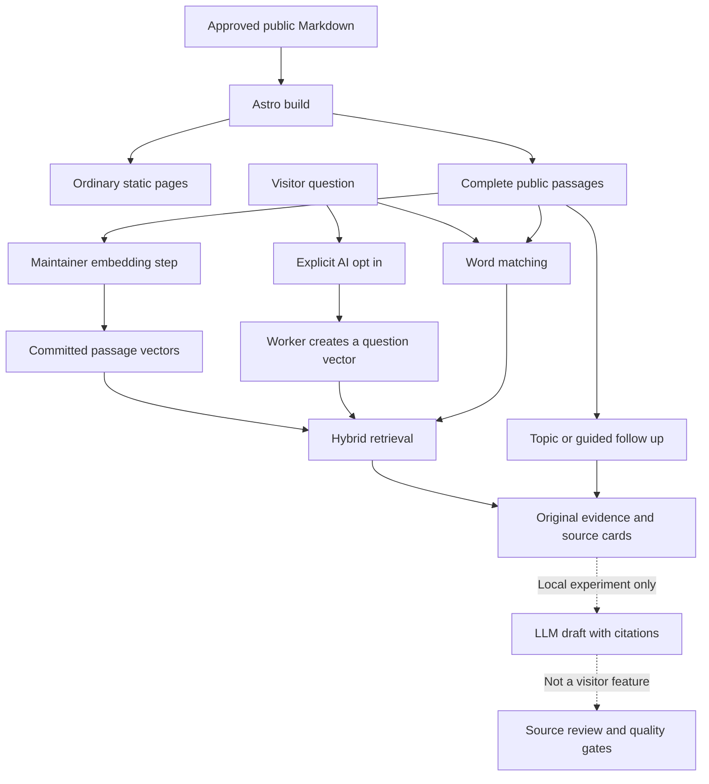

# Portfolio learning tracker

This is the revisit point for what has been built, how its components connect, and what remains experimental. Implementation status is separate from your understanding: a built component is not automatically marked as reviewed by you.

Updated: 15 November 2026. Current development checkpoint: `checkpoint/learning-lab-v1-2026-11-15` on `pilot`. The production portfolio and the development navigator are different release states.

## Open the component map

Use Node 24. After `npm run build`, run `npm run learn` and open `http://127.0.0.1:4382/` for the local learning lab. `npm run learn:build` generates a standalone copy under ignored `artifacts/learning/` for offline revisiting.

The lab lets you select a component to see its input, output, code files, exercise, and common mistake. It also compares actual word and hybrid results for saved evaluation questions. Those semantic traces use previously computed question vectors; clicking them does not run a live model. Reviewed-component checkboxes are your own local browser state. No visitor question or conversation history is persisted.

## How the existing system fits together

Reading path: public content → static build → corpus → precomputed vectors → word matching → optional worker → hybrid retrieval → navigation → source cards → request state → evaluation → deployment. Generation is an experiment after these foundations; open-ended conversation memory remains planned.

## Milestones and proof

| Milestone | Implementation | Revisit |
| --- | --- | --- |
| Typed content and static portfolio | Built | [Architecture](architecture.md) |
| Public corpus and optional semantic search | Built | [AI guide](ai-search-learning.md) |
| Search quality and actual browser inference | Built | [Verification](verification.md#search-quality-iteration-15-november-2026) |
| Topic navigator and evidence disclosures | Built | [Navigator PRD](portfolio-navigator-prd.md) |
| Visual learning lab | Built and browser-checked | [Tracker data](learning-tracker.json) |
| Grounded answer generation | First candidate rejected in native and browser screening | [Reviewed findings](../experiments/generation/results-summary.json) |
| Physical-phone inference | Not measured | Record real device and browser before making phone claims |
| Open-ended follow-up memory | Planned | Requires a new privacy and context-management decision |

## What the first generation experiment taught us

The small instruction model received the correct complete evidence directly, but passed 0/8 automated cases in both runtimes. Manual review confirmed false completion claims, reversed validation meaning, missing scope, and unsupported details. That isolates a generation failure: improving retrieval alone cannot repair an LLM that changes the supplied facts. This is a small screening result, not a general accuracy estimate.

In the lab, the generation section records each reviewed failure without publishing raw invented personal details. See [the experiment contract and commands](../experiments/generation/README.md). No model is downloaded by opening the learning lab. The experiment has not been added to `/ask/`.

## A useful study session

1. Choose one component in the map. Explain its input and output without looking at the code.
2. Open the linked implementation and find the function that crosses that boundary.
3. Run the component's exercise in a disposable development branch or the local lab.
4. Compare your prediction with the actual saved trace or test result.
5. Mark it reviewed yourself, then revisit the common mistake. A review marker records that action, not mastery.

For AI work, keep three questions separate: did retrieval find useful evidence; did the model write a supported answer; and did the actual browser perform acceptably? Passing one does not establish the other two.

## Update rule for future work

Every meaningful implementation phase should update the component input/output or status in [learning-tracker.json](learning-tracker.json), its experiment or verification evidence, and the relevant checkpoint entry. Keep existing historical results dated. Record failed experiments as outcomes rather than hiding them or labeling them shipped.

The tracker must never mark personal understanding on your behalf, index private files, or present a saved trace as live inference.
