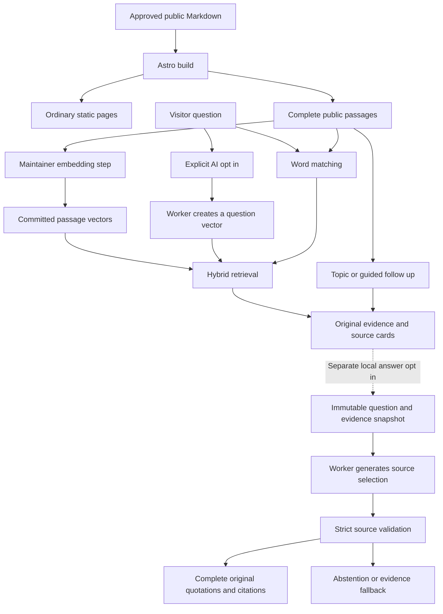
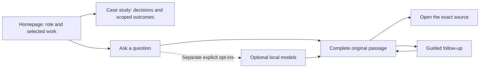
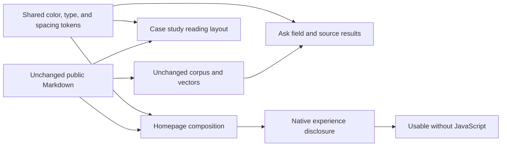
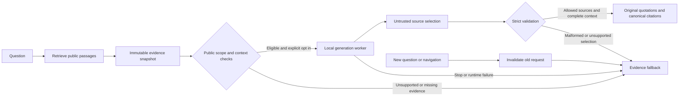

# Portfolio learning tracker

This is the revisit point for what has been built, how its components connect, and what remains experimental. Implementation status is separate from your understanding: a built component is not automatically marked as reviewed by you.

Updated: 17 November 2026. Current development checkpoint: `checkpoint/minimal-editorial-v1-2026-11-17` on `pilot`. The production portfolio and the development navigator are different release states.

## Open the component map

Use Node 24. After `npm run build`, run `npm run learn` and open `http://127.0.0.1:4382/` for the local learning lab. `npm run learn:build` generates a standalone copy under ignored `artifacts/learning/` for offline revisiting.

The tracker maps 18 components, including the new context, validation, and answer-lifecycle boundaries. The lab lets you select a component to see its input, output, code files, exercise, and common mistake. It also compares actual word and hybrid results for saved evaluation questions. Those semantic traces use previously computed question vectors; clicking them does not run a live model. Reviewed-component checkboxes are your own local browser state. No visitor question or conversation history is persisted.

## How the existing system fits together

Reading path: public content → static build → corpus → precomputed vectors → word matching → optional worker → hybrid retrieval → navigation → source cards → request state → evaluation → deployment. The local RAG path continues through context packing, generation, source validation, citations, and lifecycle handling. Model quality remains experimental; open-ended conversation memory remains planned.

## Milestones and proof

| Milestone | Implementation | Revisit |
| --- | --- | --- |
| Typed content and static portfolio | Built | [Architecture](architecture.md) |
| Public corpus and optional semantic search | Built | [AI guide](ai-search-learning.md) |
| Search quality and actual browser inference | Built | [Verification](verification.md#search-quality-iteration-15-november-2026) |
| Topic navigator and evidence disclosures | Built | [Navigator PRD](portfolio-navigator-prd.md) |
| Visual learning lab | Built and browser-checked | [Tracker data](learning-tracker.json) |
| First generation candidate | Rejected in native and browser screening | [Reviewed findings](../experiments/generation/results-summary.json) |
| Minimal Ask interface | Built and browser-checked locally | [Ask route](../src/pages/ask.astro) |
| End-to-end RAG pipeline | Built locally; model quality remains experimental | [RAG product contract](rag-prd.md) |
| Context, source validation, answer lifecycle | Implemented components with separate contract and browser checks | [Contract tests](../scripts/rag.test.mjs) and [browser checks](../scripts/verify-rag-browser.mjs) |
| Physical-phone inference | Not measured | Record real device and browser before making phone claims |
| Open-ended follow-up memory | Planned | Requires a new privacy and context-management decision |

## Read the presentation as a system

The 17 November polish adds a presentation component to the map. [The visual review](design-polish.md) connects the observed problems to the implementation and repeatable screenshots.

Revisit three decisions in the code:

1. **Hierarchy:** compare the featured employer case with the compact independent projects. The same content source feeds the page, but its visual emphasis has a purpose.
2. **Progressive disclosure:** examples are visible, topics are expandable, and model settings follow evidence. A disclosure changes when a control is seen, not its underlying capability.
3. **Evidence integrity:** the visible excerpt is a complete original passage. Its exact source link precedes it; all matching passages remain available. A layout improvement must not remove scope or change attribution.

Changing the old “Future search” heading required a new public source ID and regenerated vectors. The learning lab now replays the earlier RAG measurements against a frozen public corpus whose hash matches that experiment. Current retrieval traces still use the current corpus. This keeps historical results honest while allowing editorial changes; no model quality improvement is claimed by a UI pass.

Run the capture and browser commands in the review, then mark this component reviewed only when you have explained its input and output yourself. Model quality remains experimental and physical-phone inference remains unmeasured.

## Study the light editorial redesign

The later 17 November direction replaces the spectral theme with one continuous light canvas. The presentation component remains built; the experimental answer selector retains its experimental status. These are independent concerns.

1. **Read the tokens:** find `--text-main`, `--text-body`, `--text-support`, and the spacing scale in `global.css`. Change one on a disposable branch and predict which pages will respond.
2. **Separate grouping from framing:** inspect the project rows and the Ask source results. Whitespace, alignment, and a fine separator can organize content without a card background. Form controls retain meaningful boundaries.
3. **Understand native interaction:** open a contribution disclosure by keyboard with JavaScript disabled. Astro renders the content at build time; the browser supplies disclosure behavior.
4. **Verify the correct layer:** a screenshot can expose a bad heading wrap, while a browser assertion can protect exact original evidence. Neither replaces the other. The updated browser suite also covers 768 px and verifies that no ambient animation remains.
5. **Preserve retrieval inputs:** this pass changes presentation without editing the typed public collections. The corpus hash and committed vectors remain identical. Reindex when approved source content changes, not merely when CSS changes.

Before, foundation-review, and final images live in ignored `artifacts/design-polish/minimal-before/`, `minimal-foundation/`, and `minimal-after/`. The [design brief](design-polish.md) records the new rules and the [checkpoint record](release-checkpoints.md) identifies small reviewable commits. No personal review marker is changed by implementation work.

## What the first generation experiment taught us

The small instruction model received the correct complete evidence directly, but passed 0/8 automated cases in both runtimes. Manual review confirmed false completion claims, reversed validation meaning, missing scope, and unsupported details. That isolates a generation failure: improving retrieval alone cannot repair an LLM that changes the supplied facts. This is a small screening result, not a general accuracy estimate.

In the lab, the generation section records each reviewed failure without publishing raw invented personal details. See [the experiment contract and commands](../experiments/generation/README.md). No model is downloaded by opening the learning lab. That rejected candidate remains outside `/ask/`. The newer local RAG integration is tracked separately below.

## Follow the complete local RAG path

The 17 November implementation adds the complete local pipeline and a quieter Ask interface. Evidence search appears first. A separate model opt-in and compose action can generate a structured selection of evidence. The interface calls this an **AI-selected answer** because application code preserves original source wording. It does not present a model-written paraphrase as a verified fact.

Three new study stops explain that path:

1. **Context packing:** `prepareRag` checks the public-information boundary and creates a stable snapshot. `buildRagMessages` sends complete original evidence as data. Prompt length is checked without silently cutting qualifications.
2. **Validation and citations:** `validateRagSelection` accepts a narrow source-selection format. The application supplies the quotations and links. Required companion evidence, such as trlr's unvalidated outcome, stays attached; repairs must be counted separately from raw model success.
3. **Answer lifecycle:** `createRag` manages loading, generation, cancellation, retry, disable, cache removal, and stale results. Editing a question or choosing another topic invalidates older answer work. Progress messages can stream; unvalidated generated prose must not.

The final local implementation checks pass. Model quality remains experimental: native FLAN achieved 18/20 screening and 6/8 fresh cases; browser WASM achieved 14/20 and 4/8. Nine browser mismatches abstained and one selected an extra irrelevant source. The local lab now replays all 28 browser cases with expected versus selected evidence and full original text. This is saved evaluation, not live inference. See [the reviewed RAG record](../experiments/rag/README.md). Production model acceptance and physical-phone measurement remain pending; the failed experiments remain in the history.

Study selection quality, source integrity, and runtime behavior separately. Exact quotations prevent altered numbers and fabricated displayed wording, but they cannot establish that the selected passage answers a question or contains every needed fact. A native CPU result also does not establish browser or physical-phone performance. Keep owner review markers unchecked until you choose to mark them.

## A useful study session

1. Choose one component in the map. Explain its input and output without looking at the code.
2. Open the linked implementation and find the function that crosses that boundary.
3. Run the component's exercise in a disposable development branch or the local lab.
4. Compare your prediction with the actual saved trace or test result.
5. Mark it reviewed yourself, then revisit the common mistake. A review marker records that action, not mastery.

For AI work, keep three questions separate: did retrieval find useful evidence; did the model write a supported answer; and did the actual browser perform acceptably? Passing one does not establish the other two.

## Update rule for future work

Every meaningful implementation phase should update the component input/output or status in [learning-tracker.json](learning-tracker.json), its experiment or verification evidence, and the relevant checkpoint entry. Keep existing historical results dated. Record failed experiments as outcomes rather than hiding them or labeling them shipped.

The tracker must never mark personal understanding on your behalf, index private files, or present a saved trace as live inference.
